# sql-billionaire-wealth-analysis

**A SQL analysis of the world's 200 richest people, built with SQLite.**

## Business Problem

A global financial research organisation wants to understand how wealth is spread among the 200 richest people in the world. As the Junior Data Analyst, I used SQL to answer 15 business questions about wealth, age, country and industry.

## Key Insights

1. **Wealth is highly concentrated.** The top 10 people hold 24.37% of all wealth. They are only 5% of the list.
2. **The United States dominates.** It has 79 of the 200 billionaires. It holds about 49% of the total wealth (3,130.9 billion dollars).
3. **Technology leads.** It has the most billionaires (40) and the largest share of wealth (27.3%).
4. **Headcount does not equal wealth.** France has only 7 billionaires but ranks second in total wealth. One fortune, Bernard Arnault and family at 233 billion dollars, drives this.
5. **Averages can mislead.** Telecom has the highest average net worth (102 billion dollars). But it has one billionaire. Technology is the more reliable answer, with an average of 43.47 billion dollars across 40 people.
6. **Most billionaires are over 60.** The largest age group is 70 to 79, with 58 people.

## Tools and Skills

- **Tools:** SQLite (SQL Online), GitHub
- **SQL skills:** SELECT, WHERE, ORDER BY, LIMIT, COUNT, SUM, AVG, MAX, GROUP BY, HAVING, subqueries, CASE, JOIN

## Dataset

The data is the Top 200 Richest People in the World list, based on Forbes. The file is `Top 200 Richest Person in the World.csv`. It has 200 rows and 7 columns.

- `serial_number`: Row number
- `rank`: Global rank by net worth
- `name`: Name of the billionaire
- `age`: Age
- `country`: Country
- `networth_billion`: Net worth in billions of US dollars
- `industry`: Industry where the wealth comes from

## Data Checks

Before the analysis, I checked the data.

- All 200 rows imported correctly.
- There were no missing values.
- There were no duplicate names.
- Column types were correct.

The imported table is named `Top200RichestPersonintheWorld`.

## Business Questions and Findings

Click any question to open its finding and screenshot. The query is visible in each screenshot. The full code is in `billionaire_wealth_analysis.sql`.

<b>Q1. Who are the 20 richest billionaires?</b>

**Finding:** Bernard Arnault and family lead with 233 billion dollars. Elon Musk is second with 195 billion. Jeff Bezos is third with 194 billion.

**Why it matters:** The top 3 are separated from the rest by a wide gap. The 20th person has 77 billion dollars.

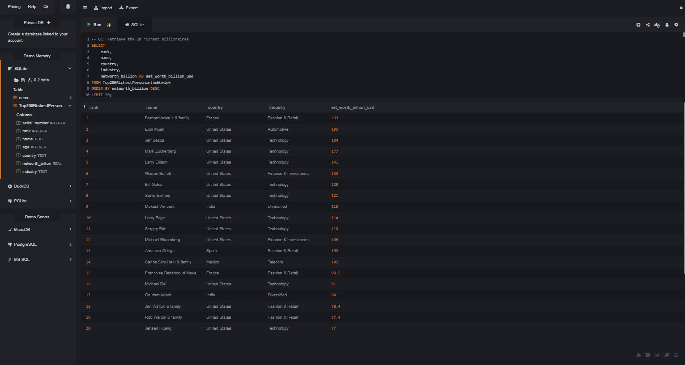

<b>Q2. Who are the five youngest billionaires?</b>

**Finding:** Mark Mateschitz is the youngest at 31. Lukas Walton is next at 37. Mark Zuckerberg, Dustin Moskovitz and Pavel Durov are all 39.

**Why it matters:** Three of the five youngest are in Technology. Young wealth is rare in this list.

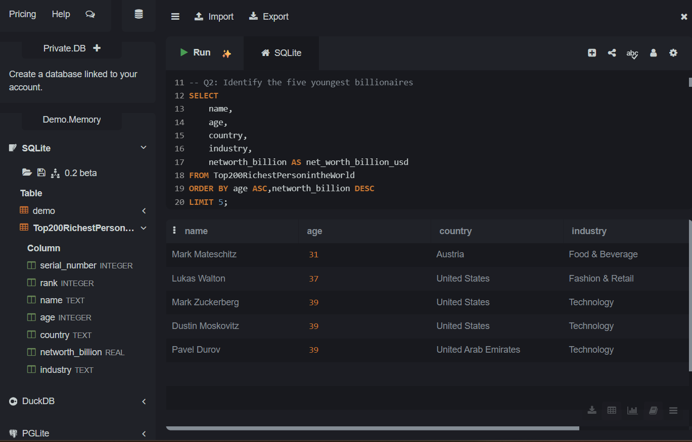

<b>Q3. What are the average age and average net worth?</b>

**Finding:** The average age is 69.38 years. The average net worth is 31.84 billion dollars.

**Why it matters:** The typical billionaire on this list is in their late 60s.

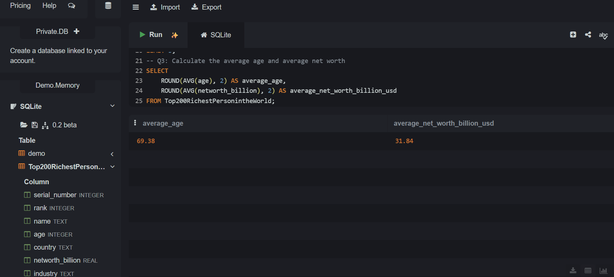

<b>Q4. Which five countries have the most billionaires?</b>

**Finding:** United States (79), China (17), India (13), Germany (11) and Russia (11).

**Why it matters:** The United States has more than the next four countries combined (52).

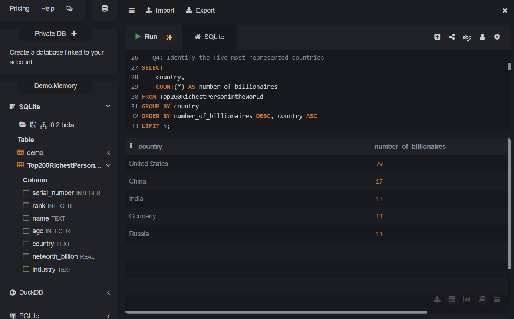

<b>Q5. What is the combined net worth by country?</b>

**Finding:** The United States holds 3,130.9 billion dollars. France is second with 478.8 billion. India is third with 434.5 billion. China is fourth with 387.4 billion.

**Why it matters:** France ranks second in wealth with only 7 billionaires. This shows that a few very large fortunes can matter more than headcount. The screenshot shows the top rows of 35 countries.

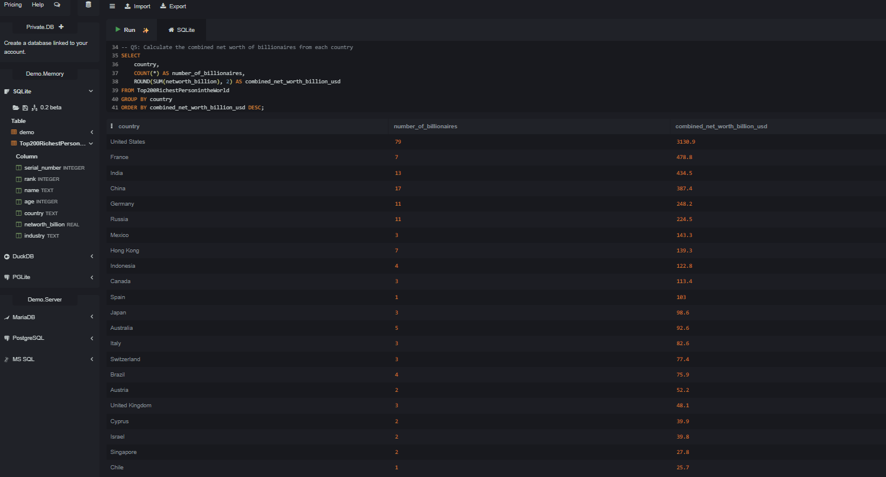

<b>Q6. Which five industries have the most billionaires?</b>

**Finding:** Technology (40), Finance and Investments (32), Fashion and Retail (30), Diversified (15) and Food and Beverage (15).

**Why it matters:** The top three industries account for 102 of the 200 billionaires.

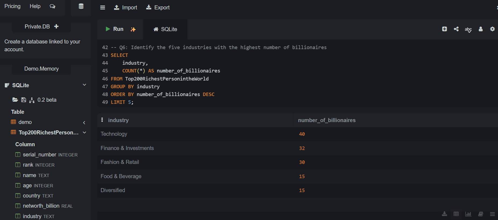

<b>Q7. Which countries have at least five billionaires?</b>

**Finding:** Eight countries qualify: United States (79), China (17), India (13), Germany (11), Russia (11), France (7), Hong Kong (7) and Australia (5).

**Method note:** I used `HAVING` instead of `WHERE`, because the filter applies to grouped counts.

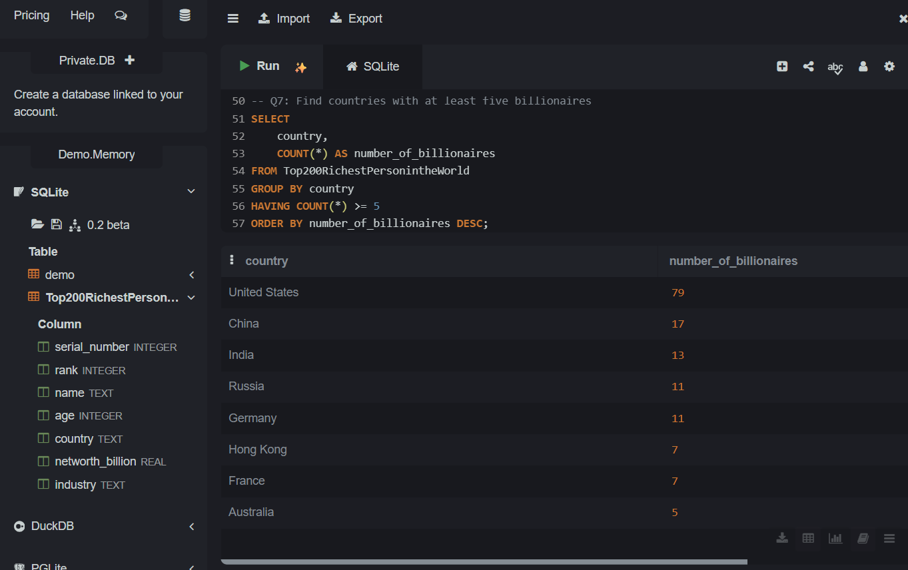

<b>Q8. What is the total wealth of billionaires younger than 50?</b>

**Finding:** There are 16 billionaires under 50. Together they hold 508.3 billion dollars.

**Why it matters:** This is about 8% of all wealth in the dataset.

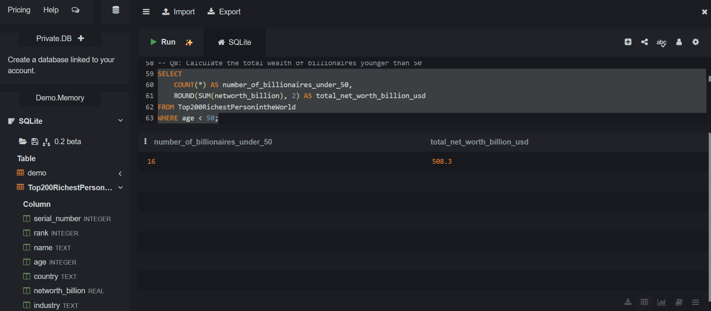

<b>Q9. Who has a net worth above the average?</b>

**Finding:** 53 of the 200 billionaires are above the average of 31.84 billion dollars.

**Method note:** I used a subquery to calculate the average inside the query. This means no number is typed by hand. The screenshot shows the top rows of 53.

**Why it matters:** Only about a quarter of the list is above average. A few very large fortunes pull the average up.

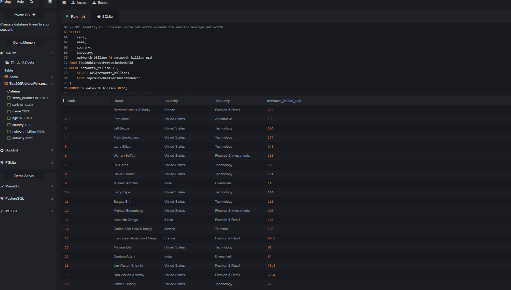

<b>Q10. Which industry has the highest average net worth?</b>

**Finding:** Telecom has the highest average at 102 billion dollars. But it has only one billionaire. Technology is more reliable, with 43.47 billion dollars across 40 people.

**Method note:** I added the headcount beside each average. This shows how much to trust each number. The screenshot shows the top rows of 18 industries.

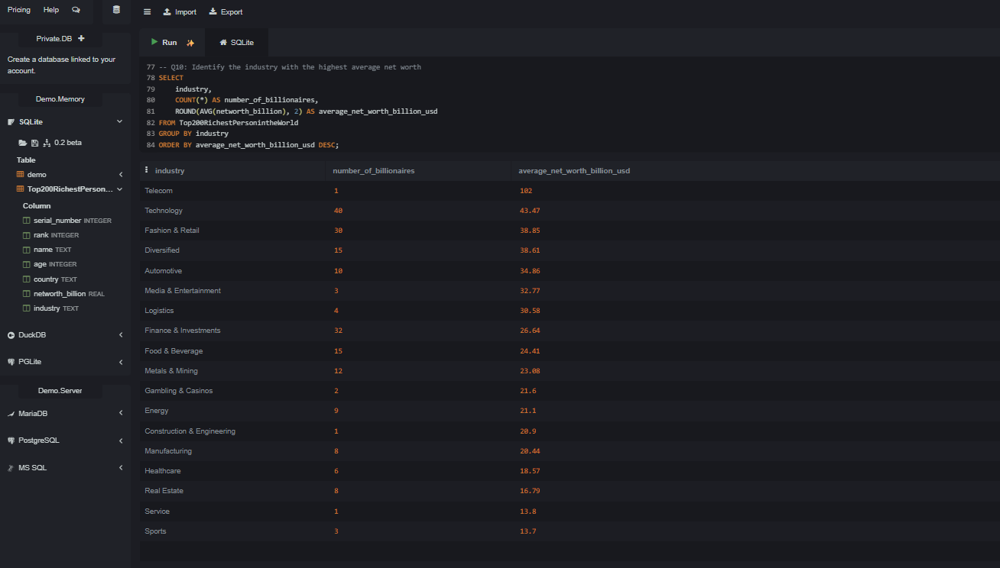

<b>Q11. Which industries hold the largest share of total wealth?</b>

**Finding:** The total wealth of all 200 people is 6,368.5 billion dollars. Technology holds 27.3%. Fashion and Retail holds 18.3%. Finance and Investments holds 13.39%.

**Why it matters:** Three industries hold nearly 60% of all the wealth. The screenshot shows the top rows of 18 industries.

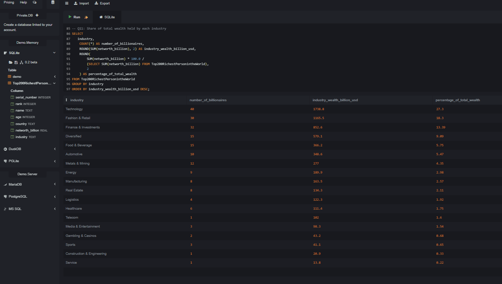

<b>Q12. How does wealth compare across age groups?</b>

**Finding:**
- Under 50: 16 billionaires, 508.3 billion dollars
- 50 to 59: 35 billionaires, 1,115.2 billion dollars
- 60 to 69: 42 billionaires, 1,527.9 billion dollars
- 70 to 79: 58 billionaires, 1,763.7 billion dollars
- 80 and above: 49 billionaires, 1,453.4 billion dollars

**Why it matters:** Most billionaires are over 60. The 60 to 69 group has the highest average net worth at 36.38 billion dollars.

**Method note:** I used a `CASE` statement to build the age groups.

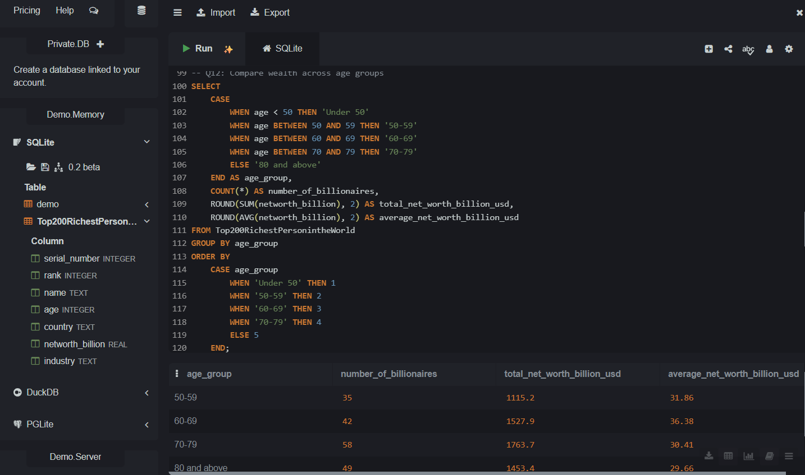

<b>Q13. Who is the richest person in each country?</b>

**Finding:** The query returns 36 rows for 35 countries. Switzerland has a tie at 33.1 billion dollars between Gianluigi Aponte and Rafaela Aponte-Diamant. I kept both because a tie is a true result.

**Method note:** I joined the table to a subquery that finds the maximum net worth per country. The screenshot shows the top rows.

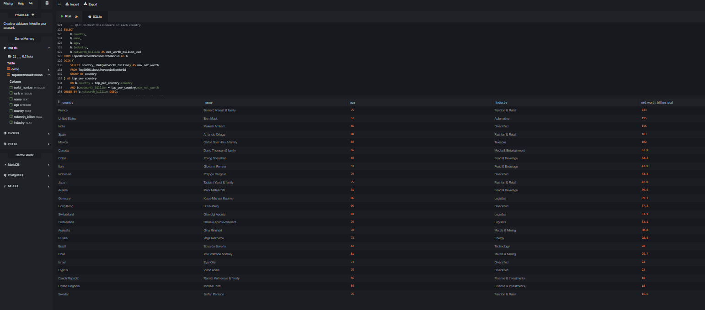

<b>Q14. How much wealth do the top 10 hold compared with the other 190?</b>

**Finding:** The top 10 hold 1,552 billion dollars (24.37%). The other 190 hold 4,816.5 billion dollars (75.63%).

**Why it matters:** The top 10 are 5% of the list but hold nearly a quarter of the wealth. This is the clearest measure of concentration in the project.

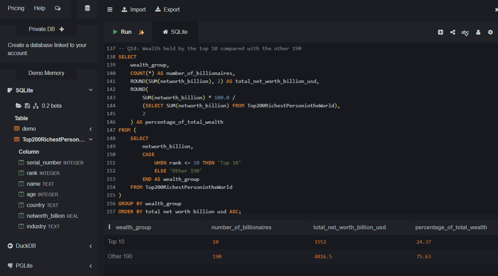

<b>Q15. Who are the five oldest billionaires?</b>

**Finding:** Robert Kuok (100, Malaysia), Lee Shau Kee (96, Hong Kong), Goh Cheng Liang (96, Singapore), Li Ka-shing (95, Hong Kong) and Lui Che Woo (95, Hong Kong).

**Why it matters:** Three of the five oldest are from Hong Kong.

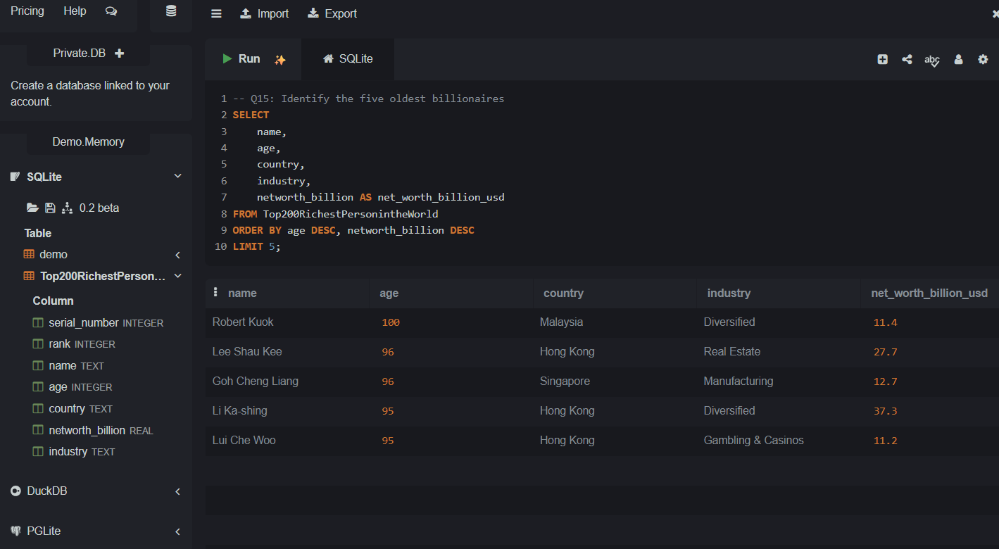

## My Approach

- I added tie-breakers to sorting so results stay in a fixed order.
- I checked for ties before using `LIMIT`, so no result was cut off unfairly.
- I showed headcounts beside averages to show how reliable each average is.
- I wrote comments on every query so others can follow my steps.

## How to Run This Project

1. Open https://sqliteonline.com and choose SQLite.
2. Import the CSV file as a table.
3. Open `billionaire_wealth_analysis.sql` and run the queries one at a time.
4. If your table name is different, replace `Top200RichestPersonintheWorld` in the queries.

## Author

**Josephine Nyantakyiwaa Sekyere**

LinkedIn: https://www.linkedin.com/in/josephinenyantakyiwaasekyere
